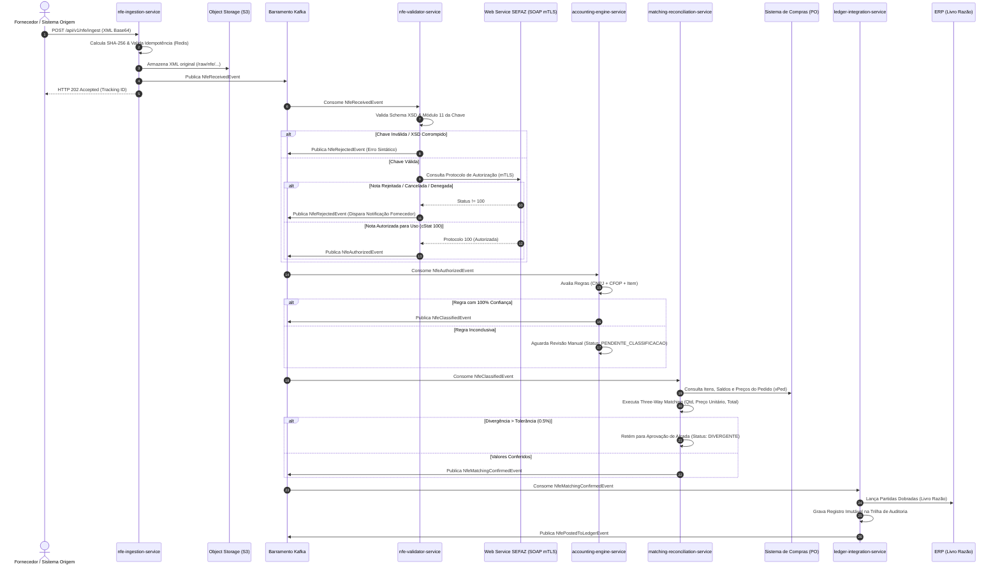

# Feature Design Doc - Processamento de Nota Fiscal

## 1. Contexto e motivação técnica

O processamento manual e descentralizado de Notas Fiscais Eletrônicas (NF-e modelo 55 e NFS-e) expõe a organização a riscos severos de ineficiência operacional, erros de digitação, glosa de créditos fiscais e escrituração indevida de notas frias, inidôneas ou canceladas na SEFAZ. Além disso, a ausência de conciliação automática entre a fatura do fornecedor e o Pedido de Compra/Contrato (*three-way matching*) ocasiona desembolsos financeiros com divergências de preços, fretes e quantidades.

Este Feature Design Doc (FDD) detalha a implementação em nível de engenharia do **Motor Automatizado de Processamento, Validação Fiscal e Escrituração Contábil de Notas Fiscais**. A solução centraliza e padroniza a ingestão multi-canal, validação algorítmica da chave de 44 dígitos, integração segura mTLS com a SEFAZ, classificação contábil baseada em regras parametrizadas, matching financeiro e integração transacional com o Livro Razão (*General Ledger*), desacoplando operações síncronas pesadas por meio de mensageria com Apache Kafka.

---

## 2. Objetivos técnicos

- Fornecer endpoints REST e consumidores de mensageria de alta performance para recepção de arquivos XML de NF-e, assegurando idempotência estrita via hash SHA-256 e chave de acesso.
- Implementar a validação algorítmica do Dígito Verificador (Módulo 11) sobre a chave de 44 dígitos com execução in-memory em sub-milissegundos ($< 1$ ms).
- Integrar com os Web Services SOAP da SEFAZ sob protocolo mTLS (HTTPS com certificado digital corporativo A1 ICP-Brasil), gerenciando timeouts conservadores ($\le 5$s), pools de conexões e retentativas exponenciais.
- Disponibilizar um motor de regras de negócio contábil em memória com cache distribuído (Redis) para sugerir contas analíticas de débito/crédito a partir do cruzamento de CNPJ, CFOP e código de item com tempo de decisão inferior a 10 ms.
- Executar a conferência automática tripartite (*Three-Way Matching*) comparando linhas do XML com o saldo e preço do Pedido de Compras, aplicando tolerâncias centesimais configuráveis.
- Garantir persistência atômica (*ACID*) e consistência eventual orientada a eventos para os lançamentos provisionais e definitivos no Livro Razão.
- Emitir telemetria nativa (métricas Micrometer/Prometheus, traces distribuídos W3C TraceContext e logs estruturados em JSON sem exposição de dados pessoais).

---

## 3. Escopo e exclusões

### Incluído:
- Camada de Ingestão: API REST (`/api/v1/nfe/ingest`), upload multipart e robô de monitoramento de diretório de rede/SFTP.
- Parser de XML NF-e seguro com desativação estrita de entidades externas (mitigação OWASP XXE).
- Algoritmo de validação do Módulo 11 da chave de acesso e validação sintática do schema XSD oficial da SEFAZ.
- Conector de comunicação SOAP com a SEFAZ estadual/nacional e suporte à contingência SVC.
- Fila de exceção e notificação automática de fornecedores (e-mail/webhook) para notas rejeitadas/denegadas.
- Motor de regras de classificação contábil com interface de revisão e aprovação manual.
- Motor de conferência de valores (*Three-Way Matching*) linha a linha e workflow de aprovação por alçadas.
- Sincronização transacional com o Livro Razão do ERP e gravação de trilha de auditoria imutável (*Audit Trail*).

### Excluído:
- Emissão própria de NF-e de saída/vendas ou notas de remessa.
- Liquidação e agendamento financeiro bancário (geração de arquivos CNAB/PIX — responsabilidade do módulo de Contas a Pagar).
- Movimentação física de estoque em almoxarifados ou sistemas de WMS.
- Gestão jurídica de recuperação tributária ou contencioso judicial contra emissores.

---

## 4. Fluxos detalhados e diagramas

### 4.1 Fluxo Sequencial de Execução da Feature



---

## 5. Contratos públicos (assinaturas, headers, exemplos)

### 5.1 Interfaces e Modelos Java (Spring Boot 3 / Java 21)

#### Assinatura do Serviço de Ingestão:
```java
package br.com.empresa.nfe.ingestion.domain;

import java.util.UUID;

public interface NfeIngestionUseCase {
    IngestionResult process(IngestionCommand command);
}

public record IngestionCommand(
    String sourceChannel,
    String filename,
    String xmlContentBase64,
    String purchaseOrderRef,
    String requestingUser
) {}

public record IngestionResult(
    UUID trackingId,
    String accessKey,
    String status,
    String s3StoragePath
) {}
```

#### Assinatura do Validador de Chave de Acesso (Módulo 11):
```java
package br.com.empresa.nfe.validator.domain;

public final class AccessKeyValidator {

    private static final int KEY_LENGTH = 44;
    private static final int[] WEIGHTS = {2, 3, 4, 5, 6, 7, 8, 9};

    public static boolean isValid(String accessKey) {
        if (accessKey == null || accessKey.length() != KEY_LENGTH || !accessKey.matches("\\d{44}")) {
            return false;
        }

        int calculatedDv = calculateCheckDigit(accessKey.substring(0, 43));
        int providedDv = Character.getNumericValue(accessKey.charAt(43));

        return calculatedDv == providedDv;
    }

    public static int calculateCheckDigit(String base43Digits) {
        int sum = 0;
        int weightIndex = 0;

        for (int i = base43Digits.length() - 1; i >= 0; i--) {
            int digit = Character.getNumericValue(base43Digits.charAt(i));
            sum += digit * WEIGHTS[weightIndex];
            weightIndex = (weightIndex + 1) % WEIGHTS.length;
        }

        int remainder = sum % 11;
        int dv = 11 - remainder;

        return (dv == 0 || dv >= 10) ? 0 : dv;
    }
}
```

### 5.2 Contrato REST de Ingestão de Nota Fiscal

- **Rota:** `POST /api/v1/nfe/ingest`
- **Headers:** 
  - `Content-Type: application/json`
  - `Authorization: Bearer <JWT>`
  - `X-Correlation-Id: <UUID>`

**Exemplo de Payload de Requisição:**
```json
{
  "sourceChannel": "PORTAL_FORNECEDOR",
  "filename": "35261100000000000191550010000123451000123456-nfe.xml",
  "xmlContentBase64": "PD94bWwgdmVyc2lvbj0iMS4wIiBlbmNvZGluZz0iVVRGLTgiPz48TkZlIHhtbG5zPSJodHRwOi8vd3d3LnBvcnRhbG5mZS5mYXplbmRhLmdvdi5ici9wb3J0YWxudmUiPjxpbmZORmU+...PC9pbmZORmU+PC9ORmU+",
  "purchaseOrderRef": "PO-BR-2026-9901"
}
```

**Exemplo de Resposta (HTTP 202 Accepted):**
```json
{
  "trackingId": "e5b8d22d-60fa-4d56-834f-0158a1bb4022",
  "accessKey": "35261100000000000191550010000123451000123456",
  "status": "QUEUED_FOR_VALIDATION",
  "receivedAt": "2026-11-15T22:10:00.123Z",
  "message": "Nota fiscal aceita com sucesso e enfileirada para conferência fiscal e contábil."
}
```

### 5.3 Evento de Integração no Apache Kafka

- **Tópico:** `nfe.events.authorized.v1`
- **Chave da Mensagem (Message Key):** `{accessKey}` (garante ordenação na partição)

```json
{
  "eventId": "a9a3b6f0-d5a8-4444-934c-255d6141c221",
  "eventType": "NfeAuthorizedEvent",
  "timestamp": "2026-11-15T22:10:04.550Z",
  "accessKey": "35261100000000000191550010000123451000123456",
  "issuerCnpj": "00000000000191",
  "recipientCnpj": "11222333000199",
  "totalAmount": 18450.00,
  "sefazProtocol": "135260000987654",
  "sefazStatusCode": 100,
  "purchaseOrderRef": "PO-BR-2026-9901",
  "s3XmlUri": "s3://corp-nfe-storage-prod/raw/2026/11/35261100000000000191550010000123451000123456.xml"
}
```

---

## 6. Configuração e opções

### Linguagem e runtime
- **Java 21 LTS (OpenJDK / Eclipse Temurin)**.
- **Spring Boot 3.3.x**, **Spring Cloud Stream** (Kafka Binder), **Spring Data JPA**, **Hibernate 6**.
- Habilitação nativa de *Virtual Threads*: `spring.threads.virtual.enabled=true`.

### Armazenamento de estado e filas
- **PostgreSQL 16+** operando em cluster primário-réplica com pool de conexões gerenciado via HikariCP.
- **Apache Kafka 3.7+** com fator de replicação mínimo 3 e `min.insync.replicas=2`.
- **Redis 7.2+** para caching de regras e locks distribuídos com Redisson.
- **AWS S3 ou MinIO** com *bucket versioning* e políticas WORM habilitadas.

### Estrutura de Opções (`application.yml` de referência)
```yaml
spring:
  threads:
    virtual:
      enabled: true
  datasource:
    hikari:
      maximum-pool-size: 25
      minimum-idle: 10
      connection-timeout: 30000
      idle-timeout: 600000
  data:
    redis:
      host: ${REDIS_HOST:localhost}
      port: ${REDIS_PORT:6379}
      timeout: 2000ms

nfe:
  ingestion:
    max-file-size-mb: 10
    idempotency-ttl-hours: 24
  sefaz:
    timeout-ms: 5000
    max-retries: 3
    backoff-multiplier: 2.0
    certificate:
      vault-path: "secret/data/fiscal/certificates/a1-corp"
      reload-interval-days: 15
  accounting:
    auto-approval-threshold: 1.00
    cache-ttl-minutes: 60
  matching:
    tolerance-percent: 0.50
    tolerance-value-cents: 100
    require-manager-approval-above: 1000.00
  ledger:
    default-mode: "DEFINITIVE" # DEFINITIVE ou PROVISIONAL
```

---

## 7. Erros, exceções e fallback

### 7.1 Concorrência e atomicidade

#### Por que é crítico:
Em períodos de fechamento fiscal ou recebimentos volumosos em lotes, o mesmo XML ou faturamento pode ser enviado simultaneamente por canais distintos (ex.: API e upload web do comprador). Além disso, a atualização no Livro Razão e o abatimento de saldo no Pedido de Compra exigem consistência transacional absoluta: uma nota jamais pode ser contabilizada duas vezes nem abater saldo incorreto do orçamento.

#### Invariantes comportamentais:
1. **Unicidade da Chave de Acesso:** A chave de 44 dígitos possui índice único restrito (`UNIQUE CONSTRAINT`) na tabela `nfe_document`.
2. **Atomicidade no Matching e Razão:** A conciliação e escrituração ocorrem sob transação `@Transactional(isolation = Isolation.READ_COMMITTED)` combinada com *Distributed Lock* no Redis via Redisson indexado por `lock:nfe:{accessKey}`.
3. **Idempotência de Ingestão:** Tentativas de reenvio do mesmo XML respondem com `HTTP 409 Conflict` e o identificador do processo existente.

### 7.2 Tratamento de Erros e Exceções Gerais

| Situação / Erro | Tratamento Técnico | Status / Ação |
| :--- | :--- | :--- |
| **Timeout na SEFAZ ($> 5$s)** | *Circuit Breaker* (Resilience4j) abre após 5 falhas consecutivas; enfileira evento com retentativa exponencial. | `STATUS: SEFAZ_RETRY_SCHEDULED` |
| **Indisponibilidade prolongada da SEFAZ** | Chaveamento automático para os Web Services de Contingência SVC-AN ou SVC-RS. | `STATUS: EM_CONTINGENCIA_SVC` |
| **Chave de 44 dígitos com DV inválido** | Interrupção imediata na camada de validação sintática; não consome cota SEFAZ. | `STATUS: CHAVE_INVALIDA` (HTTP 400) |
| **XML com entidades externas (XXE)** | O *parser* SAX rejeita o documento com `SecurityException`, gerando log de alerta de segurança. | `STATUS: XML_MALFORMADO_SEGURANCA` |
| **Divergência de valores no Matching** | O sistema não efetiva no Razão; grava os saldos divergentes e envia para fila de alçadas de suprimentos. | `STATUS: PENDENTE_APROVACAO_ALCADA` |
| **ERP Contábil indisponível** | Mensagem mantida no tópico Kafka `nfe.three-way-match`; após 5 retentativas sem sucesso, envia para DLQ. | Notificação Crítica ao time de Sustentação |

### 7.3 Modo de Contingência (Fallback)

- **Contingência Operacional da SEFAZ:** Caso a SEFAZ do estado do emitente permaneça indisponível por tempo superior a 15 minutos, o conector aciona os servidores virtuais SVC (*SEFAZ Virtual de Contingência*).
- **Fallback para Lançamentos em Fechamento de Mês:** Se o ERP contábil estiver em janela de manutenção programada no último dia do mês, o sistema persiste os lançamentos aprovados localmente em fila durável com garantia *at-least-once*, sincronizando em lote assim que o ERP retomar a operação.

---

## 8. Métricas, logs e tracing

### Métricas Prometheurs (Micrometer)
- `nfe_ingested_total{channel, status}`: Contador total de arquivos XML recebidos.
- `nfe_sefaz_latency_seconds`: Histograma de latência das chamadas SOAP da SEFAZ (buckets: 0.5s, 1s, 2s, 5s).
- `nfe_accounting_auto_classification_total{result}`: Taxa de auto-classificação vs. intervenção manual.
- `nfe_matching_divergence_total{reason}`: Divergências de preço unitário, quantidade ou frete.
- `nfe_ledger_posting_errors_total`: Falhas de escrituração contábil.

### Logs Estruturados (JSON via Logback / Slf4j)
Todos os logs são emitidos em `stdout` no formato JSON com os campos essenciais:
```json
{
  "@timestamp": "2026-11-15T22:15:30.402Z",
  "log.level": "INFO",
  "service.name": "nfe-validator-service",
  "trace.id": "4bf92f3577b34da6a3ce929d0e0e4736",
  "span.id": "00f067aa0ba902b7",
  "nfe.access_key": "35261100000000000191550010000123451000123456",
  "sefaz.status_code": 100,
  "sefaz.protocol": "135260000987654",
  "duration_ms": 1420,
  "message": "Nota fiscal autorizada com sucesso na SEFAZ SP."
}
```

### Tracing Distribuído (OpenTelemetry)
- Injeção e extração do cabeçalho `traceparent` (W3C standard) em todas as transições HTTP e mensagens Kafka.
- Spans dedicados para: `nfe.ingest`, `nfe.validate_dv`, `sefaz.soap_call`, `accounting.evaluate_rules`, `matching.compare_po`, `ledger.post_gl`.

### Proteção de Dados (LGPD) e PII
- Mascaramento rigoroso de CPFs de pessoas físicas em logs e métricas (exibição apenas no formato `***.123.456-**`).
- Chaves de logs não armazenam dados bancários de faturas.

---

## 9. Dependências e compatibilidade

| Componente / Biblioteca | Versão Mínima | Função na Feature |
| :--- | :---: | :--- |
| **Java SDK** | 21 LTS | Runtime com suporte a Virtual Threads e Records. |
| **Spring Boot** | 3.3.2 | Framework base de injeção de dependência e web. |
| **PostgreSQL** | 16.2 | Sistema gerenciador de banco de dados relacional. |
| **Apache Kafka** | 3.7.0 | Mensageria e streaming de eventos assíncronos. |
| **Redis** | 7.2.4 | Cache de regras, lock distribuído e idempotência. |
| **Redisson** | 3.32.0 | Implementação de locks distribuídos tolerantes a falhas. |
| **Apache CXF / Spring WS**| 4.0.4 | Cliente SOAP mTLS para comunicação com a SEFAZ. |
| **OpenTelemetry Java Agent** | 2.5.0 | Telemetria e instrumentação distribuída. |

---

## 10. Critérios de aceite técnicos

### Funcional e Contratos
- [x] O algoritmo Módulo 11 valida e rejeita chaves de 44 dígitos com 100% de precisão matemática.
- [x] O conector SEFAZ efetua autenticação mTLS com certificado A1 e reconhece corretamente os status 100 (autorizado), 101/102 (cancelado/inutilizado) e denegações.
- [x] O motor de classificação sugere a conta contábil em conformidade com as regras de CFOP/Fornecedor/Item.
- [x] A conferência de valores (*Three-Way Matching*) acusa divergências com tolerância centesimal ($\pm R\$ 1,00$ e $\pm 0,5\%$).
- [x] Toda alteração manual ou aprovação de divergência gera registro auditável com usuário, data, justificativa e valores anteriores.

### Testes Automatizados
- **Cobertura de Código:** Cobertura de testes unitários superior a $90\%$ no core de domínio (`domain` e `usecases`).
- **Testes de Mutação:** Testes com PiTest sobre o cálculo do Módulo 11 e regras de matching assegurando $100\%$ de mutantes eliminados.
- **Testes de Integração com Testcontainers:** Testes executando PostgreSQL, Kafka, Redis e mock de WebService SOAP da SEFAZ (via WireMock).

### Performance e Carga
- O cálculo do Módulo 11 e validação sintática ocorrem em tempo p99 $< 1$ ms.
- A consulta à SEFAZ conclui em p95 $< 2$ segundos (timeout máx. de 5s).
- Capacidade de processar rajadas de até 10.000 notas fiscais por hora com consumo de CPU do pod inferior a 70%.

---

## 11. Riscos e mitigação

| Risco Técnico Identificado | Impacto | Mitigação Arquitetural e de Engenharia |
| :--- | :---: | :--- |
| **Concorrência simultânea no lançamento contábil** | Alto | Implementação de Lock Distribuído via Redisson indexado pela chave da nota e restrição única (`unique constraint`) no PostgreSQL. |
| **Instabilidade de rede ou latência na SEFAZ** | Alto | *Circuit Breaker* com Resilience4j, timeouts estritos de 5s e chaveamento para servidores virtuais de contingência (SVC). |
| **Vulnerabilidade de injeção XML (XXE)** | Crítico | Configuração defensiva dos parsers XML (`SAXParserFactory` com `FEATURE_SECURE_PROCESSING` e `disallow-doctype-decl`). |
| **Exposição de chaves privadas do Certificado A1** | Crítico | Armazenamento no HashiCorp Vault; injeção em memória sem escrita em disco e sem log em variáveis de ambiente. |

---

### Anexos e Referências

- **Manual de Orientação do Contribuinte (MOC) - NF-e:** [Portal da Nota Fiscal Eletrônica - SEFAZ](http://www.nfe.fazenda.gov.br)
- **Documentação de Arquitetura e Negócio do Projeto:**
  - [PRD-Processamento-Nota-Fiscal.md](file:///home/vinicius-miranda/projects/DocumentationNotaFiscal/PRD-Processamento-Nota-Fiscal.md)
  - [HLD-Processamento-Nota-Fiscal.md](file:///home/vinicius-miranda/projects/DocumentationNotaFiscal/HLD-Processamento-Nota-Fiscal.md)
  - [01. Caso de Uso Projeto NF.pdf](file:///home/vinicius-miranda/projects/DocumentationNotaFiscal/01.%20Caso%20de%20Uso%20Projeto%20NF.pdf)
  - [04 .Especificação de Requisitos de Software NF.pdf](file:///home/vinicius-miranda/projects/DocumentationNotaFiscal/04%20.Especificação%20de%20Requisitos%20de%20Software%20NF.pdf)
