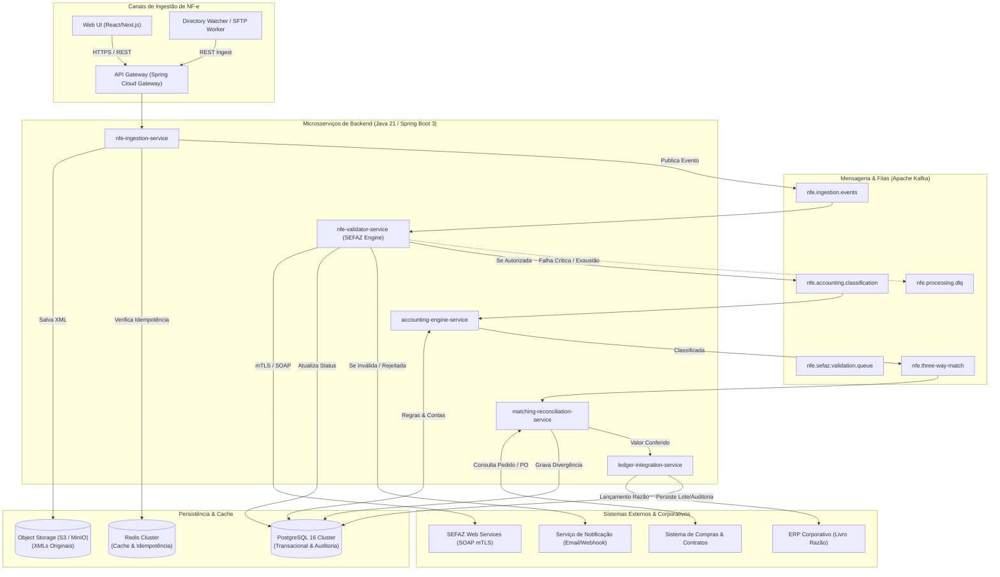
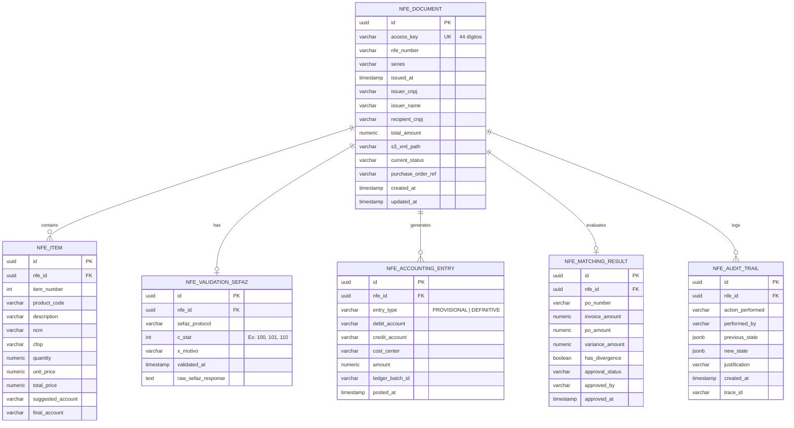

# HLD (Sistema de Processamento de Nota Fiscal)

# High-Level Design (HLD) - Plataforma Corporativa de Processamento e Escrituração de Notas Fiscais

**Versão:** v1.0  
**Data:** 15/11/2026  
**Responsável Técnico / Arquiteto:** Vinicius Miranda  
**Status:** Aprovado para Engenharia  

---

## Objetivo

Fornecer uma visão arquitetural abrangente e de alto nível dos princípios, responsabilidades e componentes do **Sistema de Processamento de Nota Fiscal**. O sistema tem como propósito automatizar e orquestrar de ponta a ponta o ciclo de vida de recepção, validação sintática e fiscal, classificação contábil, conferência de valores (*three-way matching*) e escrituração no Livro Razão (*General Ledger*) das Notas Fiscais Eletrônicas (NF-e modelo 55 e NFS-e).

A solução é desenhada para operar de forma orientada a eventos e microsserviços desacoplados, garantindo alta escalabilidade, tolerância a falhas na integração com órgãos públicos (SEFAZ), isolamento transacional (*ACID*), conformidade tributária rigorosa, estrita observância à LGPD e trilha de auditoria contábil imutável por no mínimo 12 meses.

---

## Arquitetura Geral

- **Linguagem & Runtime:** Implementado em **Java 21 LTS** sobre **Spring Boot 3.3+**, aproveitando *Virtual Threads* (Project Loom) para alta concorrência em I/O bloqueante (consultas SOAP SEFAZ, chamadas REST legadas e queries SQL).
- **Estilo Arquitetural:** Microsserviços orientados a eventos (*Event-Driven Architecture*) com orquestração assíncrona por mensageria e separação de responsabilidades em camadas (Clean Architecture / Hexagonal).
- **Containerização & Orquestração:** Empacotado via imagens padrão OCI (**Docker** multistage) e orquestrado por **Docker Compose** no ambiente de desenvolvimento local, e **Kubernetes (EKS/GKE)** em ambientes produtivos com *Horizontal Pod Autoscaler* (HPA).
- **Camada de Mensageria & Streaming:** **Apache Kafka** (ou **RabbitMQ**) atuando como barramento de eventos para ingestão, desacoplamento de chamadas lentas à SEFAZ e retentativas exponenciais com filas de *Dead Letter Queue* (DLQ).
- **Armazenamento e Persistência:**
  - **PostgreSQL 16+ (Cluster com réplicas de leitura):** Banco de dados relacional primário para dados transacionais estruturados, catálogo de regras de contas contábeis, logs de auditoria e controle de status com consistência forte (*ACID*).
  - **Object Storage compatível com AWS S3 / MinIO:** Armazenamento seguro e imutável (*WORM - Write Once, Read Many*) dos arquivos XML brutos originais e seus respectivos protocolos de autorização SEFAZ.
  - **Redis Cluster:** Cache de alta velocidade para parâmetros de classificação contábil, sessões de usuário, *circuit breaker state* e idempotência de requisições de ingestão.
- **Integração com Órgãos Fiscais:** Conector dedicado mTLS (HTTPS com certificado digital A1 ICP-Brasil) para comunicação com os *Web Services* SOAP/XML das Secretarias da Fazenda Estaduais (SEFAZ) e ambientes de contingência (SVC-AN e SVC-RS).
- **Observabilidade:** Monitoramento distribuído com **OpenTelemetry (OTel)**, exportando métricas para **Prometheus**, dashboards no **Grafana**, traces distribuídos no **Jaeger / Tempo** e centralização de logs estruturados em **Loki / Elasticsearch**.

**Representação Arquitetural (C4 — Nível 2: Contêineres):**



---

## Componentes e responsabilidades

### 1. API Gateway (`api-gateway`)
- Ponto único de entrada para tráfego externo e web.
- Autenticação corporativa via OAuth2/OIDC (JWT) e validação de permissões RBAC.
- Aplicação de Rate Limiting por IP/Tenant e proteção contra requisições malformadas (tamanho máximo de payload: 10 MB).

### 2. Ingestion Service (`nfe-ingestion-service`)
- Recebe arquivos XML via upload manual, endpoint REST público ou monitor de diretório/SFTP.
- Garante **idempotência de ingestão** consultando o hash SHA-256 e a chave de acesso no Redis.
- Grava o arquivo XML original intacto no Object Storage (S3) com assinatura de integridade.
- Publica o evento canônico `NfeReceivedEvent` no Kafka.

### 3. Fiscal Validator & SEFAZ Connector (`nfe-validator-service`)
- Valida o schema XSD oficial da NF-e e a integridade da chave de acesso de 44 dígitos através do algoritmo Módulo 11.
- Gerencia o pool de conexões mTLS com os Web Services SOAP da SEFAZ autorizadora (utilizando certificado A1 com custódia segura).
- Trata códigos de retorno da SEFAZ:
  - Código `100` (Autorizado): emite `NfeAuthorizedEvent`.
  - Códigos `101, 102, 110, 301, 302` (Cancelada/Denegada/Rejeitada): abre solicitação de correção e emite `NfeRejectedEvent`.
- Aciona o conector de notificação para fornecedores e compras em casos de rejeição.

### 4. Accounting Classification Engine (`accounting-engine-service`)
- Aplica o motor de regras de negócio contábil configuráveis por filial:
  - Prioridade 1: CNPJ Emitente + CFOP + Código/NCM do Item.
  - Prioridade 2: CFOP da Operação.
  - Prioridade 3: Categoria Padrão de Despesa.
- Calcula índice de confiança da sugestão contábil; caso atinja o limiar ($100\%$), auto-aprova a classificação.
- Fornece APIs para visualização e edição manual da conta contábil por analistas autorizados, registrando obrigatoriamente a justificativa e os dados anteriores.

### 5. Matching & Reconciliation Service (`matching-reconciliation-service`)
- Extrai a referência do Pedido de Compras (`xPed`) e itens associados.
- Integra-se ao sistema de Suprimentos para carregar linhas de fornecimento contratadas.
- Executa a conferência tripartite (*Three-Way Matching*): Quantidade Entregue vs. Saldo do Pedido; Preço Unitário vs. Preço Contratado; Valor Total e Alíquotas de Impostos.
- Gerencia workflows de divergência: se a variação estiver fora da margem de tolerância ($> \pm 0,5\%$), retém o processamento e requer aprovação gerencial de alçada.

### 6. Ledger Integration Service (`ledger-integration-service`)
- Consolida as partidas contábeis dobradas (Débito: Despesa/Ativo; Crédito: Fornecedores a Pagar; Impostos a Recuperar).
- Configura o tipo de lançamento: **Provisional** (provisão de custos temporária) ou **Definitivo**.
- Realiza a gravação atômica no Livro Razão (*General Ledger*) do ERP corporativo.
- Grava a trilha imutável de auditoria com timestamp, hash de transação e metadados de execução.

### 7. Notification & Webhook Worker (`notification-worker`)
- Envia e-mails automáticos via SMTP seguro para os fornecedores com relatórios de notas inválidas/rejeitadas.
- Dispara webhooks de atualização de status para sistemas contratantes.

---

## Fluxo de requisições (alto nível)

```
[Início] 
   │
   ▼
[1. Recepção do XML] ─── (Upload UI / API / SFTP)
   │
   ▼
[2. Armazenamento & Idempotência] ─── (Grava S3 + Cache Redis)
   │
   ▼
[3. Validação Sintática & Módulo 11]
   │
   ├── [Inválida] ──────┐
   │                    │
   ▼ [Válida]           │
[4. Consulta SEFAZ (mTLS)]
   │                    │
   ├── [Rejeitada/Timeout esgotado]
   │                    │
   │                    ▼
   │            [5. Notificação Fornecedor & Fila Espera] (Encerra ciclo até nova NF)
   ▼ [Autorizada (100)]
[6. Classificação Contábil]
   │
   ├── [Regra Conclusiva] ───► Auto-classificação
   └── [Inconclusiva] ────────► Fila de Revisão Manual do Contador
   │
   ▼
[7. Three-Way Matching] ─── (Compara NF x Pedido de Compras x Contrato)
   │
   ├── [Divergência] ────────► Alçada de Aprovação / Ajuste
   └── [Conferido]
   │
   ▼
[8. Escrituração no Livro Razão] ─── (Provisional ou Definitivo no ERP)
   │
   ▼
[9. Gravação de Auditoria & Finalização] ─── (Audit Trail imutável + Relatórios)
   │
   ▼
[Fim]
```

### Detalhamento das Etapas:
1. **Entrada:** Arquivo XML é submetido via endpoint `POST /api/v1/nfe/ingest` ou robô de pasta.
2. **Idempotência & Persistência Bruta:** O serviço calcula hash SHA-256 do arquivo e chave de acesso de 44 dígitos; rejeita duplicidades (`HTTP 409`); persiste o XML no bucket S3 `nfe-raw-storage`.
3. **Validação Estrutural:** Executa validação de integridade do XSD e validação algorítmica do Módulo 11 sobre os 44 dígitos. Se inconsistente, cancela o fluxo e alerta o remetente.
4. **Consulta Fiscal SEFAZ:** O worker consome da fila e dispara requisição SOAP com certificado digital A1 ICP-Brasil para a SEFAZ de origem.
5. **Decisão Fiscal:**
   - Se rejeitada/cancelada: emite evento de rejeição, abre chamado automático ao fornecedor e trava o fluxo.
   - Se aprovada (código 100): grava o protocolo fiscal e publica no tópico de classificação contábil.
6. **Classificação Contábil:** O motor cruza os campos `emit.CNPJ`, `det.prod.CFOP` e `det.prod.cProd`. Define Conta Débito/Crédito e Centro de Custo. Se houver divergência ou regra inexistente, entra na esteira de aprovação contábil web.
7. **Conferência de Valores (*Three-Way Match*):** O motor consome a referência de pedido (`xPed`), obtém os itens no ERP e compara quantidades e preços unitários. Em caso de divergência fora da margem de tolerância ($\pm 0,5\%$), dispara workflow de alçadas.
8. **Efetivação Contábil:** O serviço gera o lote contábil de partidas dobradas e integra transacionalmente com o Livro Razão do ERP.
9. **Auditoria & Telemetria:** Registra a transação com hash criptográfico na tabela `nfe_audit_trail`, encerra o processo com status `FINALIZADA` e atualiza as métricas no Prometheus.

---

## Modelo de dados

### Esquema Relacional Principal (PostgreSQL)



### Keyspaces e Estratégia de Cache (Redis Cluster)

- **Idempotência de Ingestão:** `nfe:idempotency:{sha256_hash}` (TTL: 24 horas).
- **Cache de Regras Contábeis:** `rules:cfop:{cfop_code}:cnpj:{issuer_cnpj}` (TTL: 1 hora, invalidado sob alteração cadastral).
- **Controle de Rate Limit da SEFAZ:** `ratelimit:sefaz:{uf_code}` (Janela deslizante para respeitar cotas da Fazenda Estadual).
- **Proteção e LGPD:** Todos os dados pessoais (CPFs de emitentes pessoa física ou motoristas de frete) são criptografados em repouso no banco via AES-256 (coluna autenticada) e mascarados em logs estruturados.

---

## Interfaces públicas e contratos de integração

### 1. Ingestão de Nota Fiscal via API REST
- **Método / Rota:** `POST /api/v1/nfe/ingest`
- **Autenticação:** Bearer JWT (Role: `ROLE_INTEGRATION_CLIENT` ou `ROLE_FISCAL_OPERATOR`)

```json
{
  "sourceChannel": "WEB_API",
  "filename": "NFe35261100000000000191550010000123451000123456.xml",
  "xmlContentBase64": "PD94bWwgdmVyc2lvbj0iMS4wIiBlbmNvZGluZz0iVVRGLTgiPz48TkZlIHhtbG5zPSJodHRwOi8vd3d3LnBvcnRhbG5mZS5mYXplbmRhLmdvdi5ici9wb3J0YWxudmUiPjxpbmZORmU+...PC9pbmZORmU+PC9ORmU+",
  "purchaseOrderRef": "PO-2026-9982"
}
```

**Resposta HTTP 202 (Accepted):**
```json
{
  "trackingId": "9b1deb4d-3b7d-4bad-9bdd-2b0d7b3dcb6d",
  "accessKey": "35261100000000000191550010000123451000123456",
  "status": "QUEUED_FOR_VALIDATION",
  "receivedAt": "2026-11-15T21:30:00Z"
}
```

### 2. Consulta de Status e Detalhes da Nota
- **Método / Rota:** `GET /api/v1/nfe/{accessKey}`
- **Resposta HTTP 200 (OK):**
```json
{
  "accessKey": "35261100000000000191550010000123451000123456",
  "status": "POSTED_TO_LEDGER",
  "issuer": {
    "cnpj": "00.000.000/0001-91",
    "name": "Fornecedor Exemplo S/A"
  },
  "totalAmount": 15420.50,
  "sefaz": {
    "statusCode": 100,
    "statusMessage": "Autorizado o uso da NF-e",
    "protocol": "135260000987654",
    "authorizedAt": "2026-11-15T21:30:02Z"
  },
  "matching": {
    "poNumber": "PO-2026-9982",
    "varianceAmount": 0.00,
    "hasDivergence": false
  },
  "accounting": {
    "entryType": "DEFINITIVE",
    "ledgerBatchId": "GL-BATCH-202611-0432"
  }
}
```

### 3. Edição Manual de Conta Contábil
- **Método / Rota:** `PATCH /api/v1/nfe/{accessKey}/accounting-classification`
```json
{
  "itemNumber": 1,
  "targetAccount": "3.1.01.02.004",
  "costCenter": "CC-LOGISTICA-01",
  "justification": "Reclassificação para despesa de transporte conforme nova diretriz fiscal 2026."
}
```

### 4. Evento de Integração em Mensageria (Kafka)
- **Tópico:** `nfe.events.v1`
- **Key:** `{accessKey}`
```json
{
  "eventId": "evt-772183",
  "eventType": "NfePostedToLedgerEvent",
  "timestamp": "2026-11-15T21:30:15Z",
  "accessKey": "35261100000000000191550010000123451000123456",
  "totalAmount": 15420.50,
  "ledgerBatchId": "GL-BATCH-202611-0432",
  "postedAt": "2026-11-15T21:30:14Z"
}
```

---

## Considerações de escalabilidade

- **Desacoplamento Assíncrono:** As operações mais pesadas e lentas (validação SEFAZ via SOAP e escrituração no ERP) são desacopladas através de partições no Kafka organizadas pela UF ou hash do CNPJ do emissor, evitando gargalos de fila única.
- **Concorrência com Virtual Threads (Loom):** Elimina o esgotamento do pool de threads em cenários de alta espera por chamadas I/O externas à SEFAZ e bancos legados.
- **Pico de Fim de Mês:** O sistema é dimensionado para absorver rajadas de até 10.000 NFs/hora através de auto-scaling de pods (HPA) baseado no *lag* dos tópicos Kafka (`nfe.ingestion.events`).
- **Cache Inteligente:** As regras de classificação contábil são cacheadas em Redis com invalidação orientada a eventos, garantindo tempo de resposta do motor de regras $< 10$ ms.
- **Particionamento de Banco:** A tabela `nfe_document` e sua respectiva `nfe_audit_trail` são particionadas por mês/ano (`partition by range (created_at)`), viabilizando queries velozes e arquivamento simplificado de períodos contábeis passados.

---

## Segurança

- **Proteção do Certificado Digital:** Certificado corporativo A1 ICP-Brasil mantido em **HashiCorp Vault** com injeção segura de segredos em runtime; a chave privada nunca é exposta em logs ou variáveis de ambiente em texto plano.
- **Transporte Seguro & mTLS:** Toda a comunicação entre o conector fiscal e a SEFAZ utiliza obrigatoriamente autenticação mTLS (autenticação mútua com certificados digitais). As rotas internas da malha operam sobre mTLS no Istio / Kubernetes Service Mesh.
- **Controle de Acesso Baseado em Papéis (RBAC):**
  - `ROLE_OPERATOR_FISCAL`: visualiza notas, inicia upload e gerencia pendências de fornecedores.
  - `ROLE_CONTABIL_SENIOR`: edita contas contábeis e parametriza regras de CFOP.
  - `ROLE_COMPRAS_APROVADOR`: aprova divergências de valores no matching.
  - `ROLE_ADMIN`: configuração global e auditoria.
- **Proteção contra Injeção XML (XXE):** Parsers XML (SAX/DOM) configurados estritamente com `disallow-doctype-decl = true` e desativação de expansão de entidades externas para mitigar vulnerabilidades OWASP XXE.
- **Trilha de Auditoria Imutável (*Audit Trail*):** Toda operação de escrita, ajuste manual ou autorização de divergência é gravada com dados anteriores, novos dados, IP, `user_id`, justificativa e correlação de `trace_id`.

---

## Observabilidade

### Indicadores Chave de Nível de Serviço (SLIs & SLOs)
- **SLO 1 (Tempo de Validação Interna):** $99\%$ das validações estruturais executadas em menos de 2 segundos.
- **SLO 2 (Disponibilidade da API Ingest):** $99,5\%$ de uptime em horário comercial.
- **SLO 3 (Confiabilidade de Escrituração):** $100\%$ de consistência nos lotes submetidos ao Livro Razão (zero duplicidade).

### Métricas Prometheus Padronizadas
- `nfe_ingested_total{channel, status}`
- `nfe_sefaz_validation_duration_seconds{uf, status_code}`
- `nfe_accounting_auto_classification_ratio`
- `nfe_matching_divergence_total{reason}`
- `nfe_processing_errors_total{component, error_type}`

### Políticas de Alertas (Alertmanager)
- **SEFAZ Unavailable (CRIT):** Taxa de erro 5xx ou timeout $> 5$s na consulta SEFAZ por mais de 3 minutos consecutivos $\rightarrow$ Notifica equipe de SRE e aciona contingência SVC.
- **High Ingestion Lag (WARN):** Lag no tópico Kafka `nfe.ingestion.events` superior a 1.000 mensagens por mais de 5 minutos $\rightarrow$ Aciona auto-scaling de pods do validador.
- **Divergence Spike (WARN):** Taxa de divergência de valores no *matching* excedendo $15\%$ do volume horário $\rightarrow$ Alerta equipe de Suprimentos.

### Tracing Distribuído & Logs
- Contexto W3C TraceContext propagado através de headers HTTP e mensagens Kafka (`traceparent`).
- Logs no formato JSON estruturado; supressão de dados cadastrais sensíveis (PII); indexação centralizada por `accessKey` e `traceId`.

---

## Riscos e mitigação

| Risco Arquitetural / Técnico | Probabilidade | Impacto | Mitigação Arquitetural |
| :--- | :---: | :---: | :--- |
| **Instabilidade / Queda da SEFAZ Estadual** | Alta | Crítico | Conector com *Circuit Breaker* (Resilience4j), retentativas assíncronas com *exponential backoff* e chaveamento automático para servidores virtuais de contingência (SVC-AN / SVC-RS). |
| **Duplicidade de Escrituração em Concorrência** | Média | Alto | Trava distribuída (*Distributed Lock* via Redis/Redlock) indexada pela chave de acesso de 44 dígitos durante a fase de gravação no Livro Razão, aliada a restrição única (`unique constraint`) no banco relacional. |
| **Comprometimento ou Expiração do Certificado A1** | Baixa | Crítico | Custódia no HashiCorp Vault com alerta automatizado de expiração a 60, 30 e 15 dias de antecedência; rotação a quente (*zero-downtime certificate reload*). |
| **Gargalo no Fechamento Contábil Mensal** | Alta | Médio | Particionamento de tópicos Kafka e particionamento de tabelas por data no PostgreSQL; autoscaling horizontal baseado em métricas de fila. |
| **Vazamento de PII em Notas de Pessoa Física** | Baixa | Alto | Criptografia em repouso no banco de dados para dados sensíveis, controle estrito de RBAC e anonimização de identificadores em logs e traces. |
