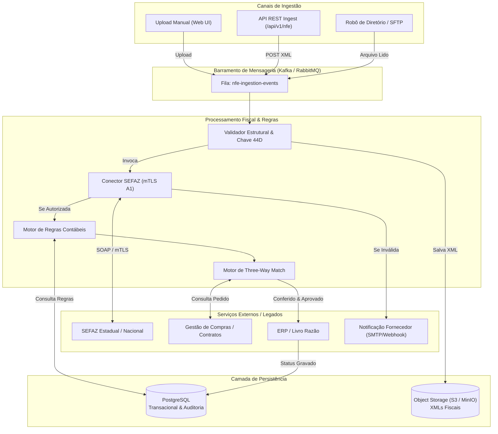

# PRD: Sistema de Processamento de Nota Fiscal

### PRD: Plataforma Corporativa de Processamento e Escrituração de Notas Fiscais

**Versão:** v1.0  
**Data:** 15/11/2026  
**Responsável:** Vinicius Miranda  
**Status:** Aprovado para Desenvolvimento  

---

### Resumo

O **Sistema de Processamento de Nota Fiscal** tem como objetivo automatizar e sistematizar de ponta a ponta o fluxo operacional de recepção, validação fiscal, classificação contábil, conferência de valores (*three-way matching*) e escrituração/lançamento contábil de Notas Fiscais Eletrônicas (NF-e). 

A solução substitui procedimentos manuais descentralizados por um fluxo digital orientado a eventos, integrado diretamente aos *Web Services* da Secretaria da Fazenda (SEFAZ), aos sistemas de compras/contratos e ao ERP/Livro Razão da companhia. Com isso, garante-se integridade contábil, conformidade tributária rigorosa, redução drástica do tempo de fechamento mensal e eliminação de riscos de autuações fiscais e pagamentos indevidos.

---

### Contexto e problema

#### Público-alvo
- **Equipe Fiscal / Tributária:** Responsável pela conferência de conformidade das NF-e junto à SEFAZ, retenções tributárias e tratamento de inconsistências de notas rejeitadas.
- **Equipe Contábil:** Contadores e analistas contábeis que realizam a parametrização do plano de contas, revisão de contas sugeridas e homologação dos lançamentos no Razão.
- **Equipe de Suprimentos / Compras:** Compradores e gestores de contratos que necessitam de conferência automática entre pedidos de compra (PO), contratos e notas fiscais entregues.
- **Fornecedores Externos:** Emissores de notas fiscais que enviam documentos eletrônicos e recebem notificações automáticas em casos de inconsistência para correção.
- **Sistemas Internos Integrados (ERP, Contas a Pagar, Barramento de Mensageria):** Serviços consumidores de dados fiscais consolidados para execução de provisões financeiras e pagamentos.

#### Cenários de uso chave
- **Ingestão Multi-Canal Contínua:** Fornecedores enviam arquivos XML/DANFE via upload em portal web, consumo direto de API REST ou monitoramento automatizado de diretório de rede/caixa de e-mail fiscal.
- **Validação Fiscal Automatizada em Tempo Real:** Validação sintática e semântica da chave de acesso de 44 dígitos, schema XML e consulta assíncrona ao *Web Service* da SEFAZ para confirmar o status de autorização (*Autorizada para Uso*).
- **Tratamento de Exceções e Devolução ao Fornecedor:** Em caso de nota cancelada, denegada ou com dados cadastrais inválidos, o sistema retém o documento em fila de pendência e dispara automaticamente uma solicitação de correção/carta de correção ou cancelamento/reemissão ao fornecedor.
- **Classificação Contábil Inteligente e Parametrizável:** Sugestão automática da conta contábil baseada no cruzamento de regras por CNPJ do Fornecedor, CFOP e código/categoria do item, permitindo revisão manual rápida antes da efetivação.
- **Conferência de Valores (*Three-Way Matching*):** Confronto automático entre o valor faturado na NF-e e os valores contratados no Pedido de Compras ou Contrato, identificando divergências de preços unitários, quantidades ou fretes.
- **Escrituração e Integração com Livro Razão:** Registro contábil (provisional ou definitivo conforme política corporativa), geração de histórico auditável e disponibilização dos lançamentos para o fechamento contábil.

#### Onde essa feature/sistema será implantada
- Plataforma Web Corporativa (*Web-based*), acessível via navegadores modernos para os usuários internos (Fiscal, Contabilidade e Suprimentos).
- Microsserviço de Backend (`fiscal-processing-service`) integrado com fila de processamento assíncrono para ingestão e validação em lote de notas fiscais.
- Conectores de integração via HTTPS/TLS com a SEFAZ estadual/nacional e barramento de integração com o ERP/Livro Razão e Gestão de Contratos.

#### Problemas priorizados
- **Processamento manual sujeito a falhas humanas:** A digitação e conferência manual geram atrasos, erros de digitação e retrabalho contínuo entre áreas fiscal e contábil.
- **Risco de escrituração de notas inidôneas ou canceladas:** Notas fiscais canceladas pelo fornecedor ou não autorizadas na SEFAZ acabam sendo escrituradas, gerando riscos tributários e glosa de créditos fiscais.
- **Divergências financeiras e pagamentos indevidos:** Falta de conciliação automática entre a NF-e e o Pedido de Compra/Contrato, resultando em pagamentos com valores incorretos.
- **Lentidão no fechamento contábil mensal:** Gargalo na classificação manual de despesas e dependência de conciliações em planilhas dispersas no final do mês.
- **Falta de rastreabilidade e auditoria:** Ausência de trilha de auditoria para fiscalizações e auditorias externas (SOX / órgãos reguladores).

---

### Objetivos e métricas

| Objetivo de Negócio | Indicador / Métrica (KPI) | Meta |
| :--- | :--- | :--- |
| Automatizar o processamento de ponta a ponta | Taxa de NFs processadas sem intervenção humana (*Straight-Through Processing*) | $\ge 95\%$ das notas recebidas |
| Agilidade na validação fiscal | Tempo médio de resposta da consulta e validação junto à SEFAZ | $\le 2$ segundos (timeout máx. 5s) |
| Acurácia na conferência financeira | Taxa de divergências de valores identificadas antes do pagamento | $100\%$ das divergências apontadas |
| Rastreabilidade e conformidade fiscal | Cobertura de logs e trilha de auditoria para lançamentos contábeis | $100\%$ das operações auditáveis |
| Disponibilidade da plataforma | Uptime do serviço em horário comercial (08:00 às 18:00) | $\ge 99,5\%$ |
| Retenção de histórico para compliance | Período de armazenamento de logs de auditoria e payloads | Mínimo de 12 meses (ativos) |

---

### Escopo

#### Incluso
- **Mecanismos de Captura Multi-canal:**
  - Upload manual via interface web (arquivos XML NF-e modelo 55 e NFS-e).
  - API REST de integração direta para ERPs, sistemas de compras e parceiros logísticos.
  - Monitoramento automático de repositórios de arquivos (pastas de rede/SFTP) e caixas postais dedicadas.
- **Motor de Validação Sintática, Estrutural e Fiscal:**
  - Validação do schema XML, digest value e formato da chave de acesso de 44 dígitos (UF, Ano/Mês, CNPJ, Modelo, Série, Número, Tipo de Emissão, Código Numérico e Dígito Verificador módulo 11).
  - Consulta em tempo real via Web Service SOAP/REST da SEFAZ para verificação da situação cadastral e autorização de uso.
- **Módulo de Exceção e Gestão de Correções:**
  - Abertura automatizada de solicitação de retificação/correção junto ao fornecedor para notas inválidas ou rejeitadas.
  - Fila de retenção (*hold queue*) com reprocessamento condicional após recebimento da NF corrigida ou Carta de Correção Eletrônica (CC-e).
- **Motor de Regras de Classificação Contábil:**
  - Mecanismo configurável de associação da conta contábil baseado em tabela de prioridade: CNPJ do fornecedor $\rightarrow$ CFOP $\rightarrow$ Categoria/Código do Item.
  - Interface web para revisão, ajuste e aprovação contábil manual com histórico de edições.
- **Módulo de Lançamento e Controle de Despesas:**
  - Geração de lançamentos contábeis nas modalidades **Provisional** (no aceite do XML) ou **Definitivo** (após conciliação completa), parametrizável por filial/empresa.
- **Conferência de Valores (*Three-Way Matching*):**
  - Confronto automático dos valores da NF com o Pedido de Compra e Contrato ativo (preço unitário, quantidade, valor total, alíquotas e frete).
  - Workflow de ajuste e aprovação para divergências dentro de tolerâncias parametrizadas.
- **Escrituração, Relatórios e Integração com Livro Razão:**
  - Consolidação e sincronização com o Livro Razão (*General Ledger*).
  - Emissão de relatórios gerenciais de conciliação, status de processamento e fechamento contábil.
  - Trilha de auditoria completa (*audit trail*) com armazenamento persistente de logs.

#### Fora de escopo
- Módulo de liquidação financeira e pagamento bancário (geração de arquivos CNAB/PIX — responsabilidade do módulo de Contas a Pagar).
- Emissão própria de NF-e de venda ou remessa (o escopo restringe-se à entrada/recebimento de notas de terceiros).
- Módulo completo de controle físico de estoque/WMS (baixa de estoque físico ocorre via sistema legado de almoxarifado/WMS integrado via eventos).
- Gestão jurídica de contencioso fiscal contra fornecedores inadimplentes.

---

### Requisitos funcionais

#### RF-001 Recebimento de Nota Fiscal Multi-canal
Permitir a entrada de notas fiscais eletrônicas através de upload manual na interface web, chamadas via API REST ou robô de monitoramento de diretório.

- **Fluxo principal:**
  1. O sistema recebe o documento fiscal eletrônico (XML) através de um dos canais disponíveis (Upload UI, API `/api/v1/nfe/ingest` ou robô de pasta monitorada).
  2. O sistema realiza a validação preliminar do formato do arquivo e armazena o XML íntegro no *Object Storage*.
  3. O sistema cria um registro na fila de processamento com o status `RECEBIDA` e emite o evento de ingestão.
- **Fluxos alternativos e exceções:**
  - *Arquivo corrompido ou formato inválido:* O sistema rejeita o arquivo imediatamente, registrando log de erro e retornando mensagem clara ao usuário ou sistema de origem (`HTTP 400 - Arquivo XML inválido ou corrompido`).
  - *Arquivo em duplicidade (mesma chave de acesso já cadastrada):* O sistema identifica a duplicidade, bloqueia a nova inserção e exibe o link do processo existente (`HTTP 409 - Nota Fiscal já cadastrada`).
- **Erros previstos:**
  - Falha de conexão de rede durante o upload; limite de tamanho de payload excedido ($> 10$ MB).
- **Prioridade:** Must Have (Alta)

---

#### RF-002 Extração Automatizada de Dados da NF
Extrair e estruturar todos os dados fiscais e tributários contidos no XML da nota recebida.

- **Fluxo principal:**
  1. O *parser* consome o XML da nota fiscal da fila de processamento.
  2. Extrai os dados do cabeçalho: Chave de acesso, Número da NF, Série, Data/Hora de Emissão, Natureza da Operação.
  3. Extrai dados do Emitente/Fornecedor: CNPJ/CPF, Razão Social, Inscrição Estadual, Endereço.
  4. Extrai dados do Destinatário: CNPJ, Razão Social.
  5. Extrai itens de mercadoria/serviço: Código do produto, Descrição, NCM, CFOP, Unidade, Quantidade, Valor Unitário, Valor Total e tributos incidentes (ICMS, IPI, PIS, COFINS, ISSQN).
  6. Extrai totais da fatura, cobranças e dados adicionais de interesse do fisco.
  7. Persiste os dados estruturados no modelo relacional associado à NF.
- **Fluxos alternativos e exceções:**
  - *Campos obrigatórios ausentes no XML:* Caso campos essenciais exigidos pelo layout oficial da NF-e estejam ausentes, o sistema classifica a NF como `DADOS_INCOMPLETOS` e encaminha para fila de análise.
- **Erros previstos:**
  - Incompatibilidade de versão do schema XML da NF-e (ex.: layout descontinuado da SEFAZ).
- **Prioridade:** Must Have (Alta)

---

#### RF-003 Validação Estrutural e da Chave de Acesso
Validar a formatação, consistência sintática e dígito verificador da chave de acesso de 44 dígitos da NF-e.

- **Fluxo principal:**
  1. O sistema obtém a chave de acesso extraída no RF-002.
  2. Valida o comprimento (exatos 44 caracteres numéricos).
  3. Decompõe os blocos constituintes: cUF (2), AAMM (4), CNPJ (14), mod (2), serie (3), nNF (9), tpEmis (1), cNF (8), cDV (1).
  4. Executa o algoritmo de cálculo do Módulo 11 sobre os primeiros 43 dígitos e compara com o dígito verificador (cDV) informado.
  5. Se válido, atualiza o status para `CHAVE_VALIDADA` e avança para validação na SEFAZ.
- **Fluxos alternativos e exceções:**
  - *Chave de acesso inválida ou DV inconsistente:* O sistema sinaliza o erro, atualiza o status para `CHAVE_INVALIDA` e impede o prosseguimento do fluxo.
- **Erros previstos:**
  - Caracteres alfanuméricos ou chave truncada.
- **Prioridade:** Must Have (Alta)

---

#### RF-004 Consulta e Validação de Situação na SEFAZ
Verificar a situação cadastral e autorização de uso da NF-e em tempo real junto aos servidores da Secretaria da Fazenda.

- **Fluxo principal:**
  1. O sistema estabelece conexão segura (mTLS / HTTPS com certificado digital A1 corporativo) com o *Web Service* de Consulta Protocolo da SEFAZ do estado do emitente.
  2. Envia a requisição contendo a chave de acesso.
  3. Recebe e interpreta o protocolo de resposta:
     - Código `100` (*Autorizado o uso da NF-e*): Atualiza o status para `AUTORIZADA_SEFAZ`.
  4. Armazena o protocolo de autorização, data/hora e mensagem de retorno para fins de comprovação fiscal.
- **Fluxos alternativos e exceções:**
  - *Nota Cancelada, Inutilizada ou Denegada (Códigos 101, 102, 110, 301, 302):* O sistema marca o documento como `REJEITADA_SEFAZ`, anexa a justificativa do fisco e aciona o RF-005.
  - *SEFAZ Indisponível ou Timeout ($> 5$ segundos):* O sistema enfileira a requisição com mecanismo de *backoff* exponencial e chave de contingência, notificando a esteira operacional após 3 tentativas falhas.
- **Erros previstos:**
  - Certificado digital A1 expirado ou revogado; instabilidade sistêmica no ambiente da SEFAZ autorizadora.
- **Prioridade:** Must Have (Alta)

---

#### RF-005 Solicitação de Correção ao Fornecedor
Automatizar o tratamento e a notificação de notas fiscais inválidas ou rejeitadas pela SEFAZ.

- **Fluxo principal:**
  1. Identificada a rejeição na validação estrutural ou SEFAZ, o sistema suspende o processamento da NF (`STATUS: AGUARDANDO_CORRECAO`).
  2. Abre uma ocorrência no sistema contendo o detalhamento da não-conformidade.
  3. Dispara notificação por e-mail e webhook ao fornecedor emitente, com cópia para o comprador responsável.
  4. Disponibiliza link seguro para que o fornecedor envie a Carta de Correção Eletrônica (CC-e) ou a nova NF-e substituta.
- **Fluxos alternativos e exceções:**
  - *Fornecedor reenvia NF válida:* O sistema faz o vínculo automático da nova nota à solicitação pendente, encerra a pendência e reinicia o fluxo a partir do RF-001.
  - *Prazo de resposta expirado:* Após 5 dias úteis sem retorno, o sistema escala alerta para o gestor da área de compras.
- **Erros previstos:**
  - E-mail do fornecedor não cadastrado ou falha no serviço SMTP.
- **Prioridade:** Should Have (Média-Alta)

---

#### RF-006 Identificação da Conta Contábil (Classificação de Despesa)
Identificar e atribuir a conta contábil analítica e o centro de custo apropriados para o lançamento da despesa.

- **Fluxo principal:**
  1. O motor de classificação contábil avalia os dados da NF-e contra as tabelas de parametrização da empresa:
     - Regra 1: Cruzamento do CNPJ do Fornecedor com catálogo de fornecedores homologados.
     - Regra 2: CFOP da operação (ex.: 1.556/2.556 - Compra de material para uso ou consumo; 1.102/2.102 - Compra para comercialização).
     - Regra 3: Código NCM ou código do item de compra.
  2. O sistema sugere a Conta Contábil Débito/Crédito e Centro de Custo com índice de confiança.
  3. Caso a regra atinja 100% de aderência pré-aprovada, a classificação é confirmada automaticamente.
- **Fluxos alternativos e exceções:**
  - *Classificação Manual:* Se não houver regra conclusiva, a nota entra na esteira de trabalho do analista contábil (`STATUS: PENDENTE_CLASSIFICACAO`), que seleciona a conta contábil no plano de contas corporativo.
  - *Alteração de sugestão automática:* O contador com perfil autorizado pode editar a conta contábil sugerida, devendo obrigatoriamente registrar justificativa de negócio.
- **Erros previstos:**
  - Conta contábil bloqueada para lançamentos ou inativa no ERP.
- **Prioridade:** Must Have (Alta)

---

#### RF-007 Registro e Lançamento de Despesa
Registrar os lançamentos contábeis no sistema financeiro/contábil com base nas definições apuradas.

- **Fluxo principal:**
  1. O sistema consolida as partidas contábeis: Débito (Conta de Despesa/Ativo/Estoque), Crédito (Fornecedores Nacionais a Pagar) e parcelas de impostos a recuperar (ex.: ICMS a recuperar, PIS/COFINS a recuperar).
  2. Verifica a parametrização corporativa da empresa/filial: modalidade **Provisional** ou **Definitivo**.
  3. Cria o lançamento no sistema contábil, vinculando a chave de acesso da NF, data de competência, valor líquido e tributos.
  4. Gera o identificador único do lote/lançamento contábil.
- **Fluxos alternativos e exceções:**
  - *Lançamento Provisional configurado:* O sistema grava a provisão de custos e gera tarefa agendada para conversão em lançamento definitivo após a conferência de valor (RF-008).
- **Erros previstos:**
  - Período contábil já encerrado (trava de competência contábil); desbalanceamento entre soma de débitos e créditos.
- **Prioridade:** Must Have (Alta)

---

#### RF-008 Conferência de Valores (*Three-Way Matching*)
Comparar e confrontar os valores faturados na NF-e contra os documentos de origem (Pedido de Compra e Contrato).

- **Fluxo principal:**
  1. O sistema localiza o número do Pedido de Compra (campo `xPed`) ou número de Contrato referenciado na NF-e.
  2. Recupera do sistema de compras os itens, preços unitários, quantidades e valores totais autorizados.
  3. Realiza o matching linha a linha:
     - Valor Unitário NF $\times$ Valor Unitário Pedido.
     - Quantidade Entregue $\times$ Saldo Pendente do Pedido.
     - Valor Total da Fatura $\times$ Valor Total Aprovado.
  4. Se todos os valores conferirem perfeitamente, o sistema emite o status `VALOR_CONFERIDO` e avança para finalização.
- **Fluxos alternativos e exceções:**
  - *Divergência de valores identificada:* Se houver variação acima da margem de tolerância aceitável (ex.: $\pm 0,5\%$ ou $\pm R\$ 1,00$), o sistema bloqueia o avanço, sinaliza o ponto de divergência e aciona o RF-009.
- **Erros previstos:**
  - Pedido de Compra não localizado ou já encerrado por outro documento fiscal.
- **Prioridade:** Must Have (Alta)

---

#### RF-009 Tratamento e Atualização de Lançamento em Divergência
Permitir a conciliação, retificação de valores e atualização do lançamento contábil em casos de divergência.

- **Fluxo principal:**
  1. Identificada a divergência no RF-008, o sistema abre uma tarefa de conciliação fiscal/suprimentos com os dados comparativos (Valor NF vs. Valor Pedido).
  2. O analista responsável verifica a causa raiz (ex.: reajuste de frete acordado, variação de alíquota tributária ou faturamento incorreto do fornecedor).
  3. Se aprovado o ajuste: o sistema atualiza o valor do lançamento contábil, reajusta o saldo do pedido e registra o aditivo com a respectiva aprovação gerencial.
  4. Se rejeitado o ajuste: o documento é encaminhado para devolução de mercadoria ou emissão de nota de débito/crédito complementar.
- **Fluxos alternativos e exceções:**
  - *Aprovação por Alçada Superior:* Divergências com impacto financeiro superior ao limite estabelecido (ex.: $> R\$ 1.000,00$) exigem dupla aprovação (Gerência de Compras e Controladoria).
- **Erros previstos:**
  - Tentativa de aprovação de divergência por usuário sem permissão de alçada.
- **Prioridade:** Should Have (Média-Alta)

---

#### RF-010 Finalização de Lançamento e Disponibilização para Livro Razão
Consolidar a escrituração no Livro Razão e gerar relatórios executivos para fechamento contábil.

- **Fluxo principal:**
  1. Com a nota conferida e classificada, o sistema executa a transação de efetivação no Livro Razão (*General Ledger*).
  2. Atualiza o status do processo para `FINALIZADO_CONCILIADO`.
  3. Atualiza os saldos das contas contábeis correspondentes na base oficial do ERP.
  4. Disponibiliza o registro fiscal para os relatórios de fechamento contábil mensal e demonstrativos contábeis (DRE/Balanço).
  5. Emite comprovante eletrônico de processamento da NF-e para arquivamento digital.
- **Fluxos alternativos e exceções:**
  - *Falha na gravação no Livro Razão:* Em caso de indisponibilidade da base do Razão, a operação sofre *rollback*, mantendo o lançamento em fila para retry com consistência transacional assegurada.
- **Erros previstos:**
  - Conflito de concorrência ou bloqueio de tabela contábil durante rotina de fechamento de período.
- **Prioridade:** Must Have (Alta)

---

### Requisitos não funcionais

#### Performance e Escalabilidade
- **Tempo de Resposta das Validações Internas:** $\le 2$ segundos para validações estruturais de chave de acesso, schema XML e classificação de regras contábeis.
- **Tempo de Consulta SEFAZ:** Limite máximo de espera de 5 segundos por chamada; implementação de fila assíncrona desacoplada para evitar travamento da interface.
- **Processamento em Lote:** O sistema deve suportar a ingestão e processamento de até 10.000 notas fiscais por hora sem degradação perceptível de performance.

#### Disponibilidade e Tolerância a Falhas
- **Disponibilidade Global:** Mínimo de 99,5% de disponibilidade mensal em horário comercial (08:00 às 18:00 de segunda a sexta-feira).
- **Recuperação de Desastres:** RPO (*Recovery Point Objective*) igual a zero para transações confirmadas no Livro Razão e RTO (*Recovery Time Objective*) menor que 2 horas.

#### Segurança, Criptografia e Autorização
- **Comunicação Criptografada:** Todas as comunicações internas e externas (SEFAZ, ERP, Web Services) devem utilizar obrigatoriamente HTTPS com TLS 1.3.
- **Gestão de Identidade e Acesso:** Autenticação via Single Sign-On corporativo (OAuth2 / OpenID Connect / SAML 2.0) e controle de acesso baseado em papéis (RBAC - Perfis: *Fiscal*, *Contador*, *Aprovador de Compras*, *Administrador do Sistema*).
- **Armazenamento de Certificados Digitais:** Certificados digitais A1/A3 utilizados para comunicação com a SEFAZ devem ser custodiados em cofre de senhas seguro (*Secret Vault*).

#### Observabilidade e Auditoria
- **Armazenamento de Logs:** Manutenção de logs de auditoria detalhados por período mínimo de 12 meses em ambiente acessível e retenção fria por 5 anos (atendimento à legislação fiscal do SPED).
- **Rastreabilidade Ponta a Ponta:** Todo lançamento contábil deve permitir auditoria reversa exibindo: usuário/sistema que originou, timestamp UTC, XML bruto original, retorno da SEFAZ, regras contábeis aplicadas e eventuais intervenções manuais.
- **Monitoramento de Métricas:** Telemetria com monitoramento em tempo real de taxas de erro por rota, tempo de fila, status de conectividade com a SEFAZ e consumo de recursos.

#### Confiabilidade e Integridade de Dados
- **Transacionalidade ACID:** O registro no Livro Razão e o abatimento no Pedido de Compra devem ser estritamente atômicos (Two-Phase Commit ou padrão SAGA com ações compensatórias).
- **Imutabilidade do Histórico Fiscal:** Uma vez finalizado o lançamento, os registros originais de auditoria tornam-se somente-leitura (*append-only*).

#### Compatibilidade e Portabilidade
- **Front-end:** Interface web 100% responsiva, homologada e compatível com as versões estáveis dos navegadores Google Chrome, Mozilla Firefox, Microsoft Edge e Safari.
- **Back-end:** Arquitetura empacotada em contêineres padrão OCI (Docker), pronta para execução em orquestrador Kubernetes.

#### Conformidade e Compliance (LGPD e Fiscal)
- **LGPD:** Mascaramento e proteção de dados pessoais presentes em notas fiscais de pessoas físicas (prestadores autônomos ou clientes), assegurando armazenamento restrito aos propósitos legais de compliance fiscal.
- **Conformidade SPED:** Os dados gerados devem estar em estrita conformidade com os leiautes dos blocos fiscais do SPED Fiscal (EFD ICMS/IPI) e SPED Contribuições.

---

### Arquitetura e abordagem



#### Abordagem de Sistema
O sistema adota uma arquitetura orientada a serviços e eventos (*Event-Driven Architecture*). O recebimento da nota fiscal é desacoplado do processamento pesado e das consultas a serviços externos de alta latência (como a SEFAZ) por meio de filas de mensageria. Isso assegura que picos de envio no fechamento do mês não sobrecarreguem o sistema nem resultem em perda de requisições.

#### Componentes Principais
1. **Frontend Corporativo (Portal Fiscal):** Aplicação Single Page Application (SPA) para gestão da fila operacional, dashboard analítico, correção manual de notas e auditoria.
2. **Ingestion & Validation Gateway:** Ponto de entrada das notas fiscais, encarregado de autenticação, validação sintática do XML e cálculo do dígito verificador da chave.
3. **SEFAZ Connector Service:** Módulo dedicado à comunicação mTLS segura com os Web Services governamentais, com gerenciamento de contingência e renovação de certificados digitais.
4. **Classification & Matching Engine:** Motor de negócio que cruza regras contábeis e orquestra a conciliação linha a linha contra pedidos de compras.
5. **Ledger Integration Adapter:** Adaptador de sincronização transacional com o Livro Razão corporativo.
6. **Data Storage:**
   - **Banco de Dados Relacional (PostgreSQL):** Dados transacionais, relacionamentos, parâmetros fiscais e logs de auditoria.
   - **Object Storage (S3/MinIO):** Repositório de arquivos XML originais assinados digitalmente.

#### Decisões e trade-offs

##### Decisão 1: Processamento Assíncrono com Filas de Mensageria
- **Justificativa:** A SEFAZ possui oscilações frequentes de latência e eventuais instabilidades temporárias. O uso de filas assíncronas isola o usuário da lentidão do fisco e garante retry transparente.
- **Trade-off:** Exige gerenciamento de consistência eventual e mecanismos robustos de notificação via WebSockets na interface web para informar o usuário quando a validação for concluída.

##### Decisão 2: Motor de Regras Parametrizável em Banco Relacional
- **Justificativa:** Permite que analistas contábeis seniores configurem novas associações de CFOP e contas contábeis diretamente pelo painel administrativo, sem necessidade de *deploy* de novo código.
- **Trade-off:** Exige validação rigorosa de integridade referencial para impedir que regras conflitantes gerem ambiguidade na classificação.

---

### Mapeamento de integrações e contratos de dados

#### Contrato de Ingestão via API REST
- **Endpoint:** `POST /api/v1/nfe/ingest`
- **Cabeçalhos:** `Authorization: Bearer <JWT>`, `Content-Type: application/json`

**Payload de Exemplo (Envio):**
```json
{
  "origem": "INTEGRACAO_ERP",
  "nomeArquivo": "NFe35261100000000000191550010000123451000123456.xml",
  "xmlBase64": "PD94bWwgdmVyc2lvbj0iMS4wIiBlbmNvZGluZz0iVVRGLTgiPz48TkZlIHhtbG5zPSJodHRwOi8vd3d3LnBvcnRhbG5mZS5mYXplbmRhLmdvdi5ici9wb3J0YWxudmUiPjxpbmZORmU+...PC9pbmZORmU+PC9ORmU+",
  "pedidoCompraReferencia": "PO-2026-9982",
  "solicitante": "sistema.compras@empresa.com"
}
```

**Resposta de Exemplo:**
```json
{
  "protocoloIngestao": "ING-20261115-00874",
  "chaveAcesso": "35261100000000000191550010000123451000123456",
  "status": "RECEBIDA",
  "dataRecebimento": "2026-11-15T20:15:30Z",
  "mensagem": "Arquivo recebido com sucesso e enfileirado para validação."
}
```

---

### Dependências

#### Dependência externa: Disponibilidade e Conectividade SEFAZ
- O processamento tempestivo da validação depende diretamente do funcionamento dos Web Services da SEFAZ nos 27 estados. É mandatório manter contingência SCAN/SVC e certificados digitais A1 válidos.

#### Dependência organizacional: Parametrizador de Alçadas e Plano de Contas
- A Controladoria e a equipe Contábil devem manter o plano de contas devidamente estruturado e definir formalmente as matrizes de alçada de aprovação para divergências financeiras.

#### Dependência técnica: Barramento de Integração com o ERP Legado
- Disponibilidade de APIs ou filas seguras para leitura de Pedidos de Compra e gravação dos lançamentos definitivos nas tabelas de Livro Razão do ERP corporativo.

---

### Riscos e mitigação

#### Risco 1: Indisponibilidade ou instabilidade da SEFAZ no fechamento de mês
- **Probabilidade:** Alta
- **Impacto:** Crítico
- **Mitigação:** 
  - Fila de contingência assíncrona com retentativas inteligentes (*exponential backoff*).
  - Alerta antecipado para a equipe fiscal e chaveamento para servidores de contingência virtual (SVC-AN / SVC-RS).
- **Plano de contingência:** Permitir emissão de lançamento provisional condicional com trava de pagamento até autorização definitiva.

#### Risco 2: Escrituração de NF com valores divergentes do Pedido de Compra
- **Probabilidade:** Média
- **Impacto:** Alto
- **Mitigação:**
  - Bloqueio sistêmico automatizado no motor de matching para qualquer divergência superior à margem configurada.
  - Exigência de dupla aprovação com registro em trilha de auditoria para exceções autorizadas.
- **Plano de contingência:** Estorno contábil automático e notificação imediata à tesouraria para sustar autorização de pagamento.

#### Risco 3: Classificação contábil incorreta gerando distorção de balanço
- **Probabilidade:** Média
- **Impacto:** Alto
- **Mitigação:**
  - Validação cruzada estrita entre CFOP da nota e a natureza da conta contábil sugerida.
  - Amostragem diária enviada para revisão preventiva por analista contábil sênior.
- **Plano de contingência:** Rotina de reclassificação contábil em lote com histórico de versão preservado.

---

### Critérios de aceitação

Checklist objetivo que define se o produto/funcionalidade está pronto para homologação e entrada em produção:

- [ ] O sistema ingere arquivos XML válidos via Upload Web, API REST e leitura de pasta monitorada sem perda de mensagens.
- [ ] O sistema extrai e valida com exatidão a chave de 44 dígitos através do algoritmo Módulo 11.
- [ ] A consulta à SEFAZ valida o status da nota e impede o avanço de notas canceladas ou denegadas.
- [ ] Notas fiscais rejeitadas geram abertura de ocorrência e notificação automática ao fornecedor com registro em log.
- [ ] O motor contábil sugere a conta contábil baseada nas regras de CFOP, fornecedor e item, permitindo edição justificada.
- [ ] O sistema permite configurar a emissão de lançamentos na modalidade provisional ou definitiva.
- [ ] O confronto de valores com o Pedido de Compra acusa divergências de preço e quantidade com precisão centesimal.
- [ ] Toda intervenção manual (ajuste de conta, tolerância de valor) gera registro auditável com usuário, data, justificativa e valores anteriores.
- [ ] A gravação no Livro Razão atualiza os saldos contábeis sem inconsistências de partidas dobradas.
- [ ] O tempo médio de validação interna permanece abaixo de 2 segundos.
- [ ] O painel web exibe status em tempo real e opera fluidamente nos navegadores Chrome, Firefox e Edge.

---

### Planejamento de Sprints e Entregas (Processo no Jira)

Conforme estabelecido no planejamento de engenharia, cada épico será executado em sprints de 4 semanas (1 mês de esforço por épico):

| Épico | Sprint / Período | Escopo Principal Entregue |
| :--- | :--- | :--- |
| **Épico 1: Captura e Validação de Notas Fiscais** | Sprint 1 (Semanas 1 a 4) | Ingestão multi-canal (Upload, API, Robô), *parser* de XML, validação de chave de 44 dígitos, integração Web Service SEFAZ e workflow de notificação de erros para fornecedores (US 1.1 a 1.4). |
| **Épico 2: Classificação Contábil** | Sprint 2 (Semanas 5 a 8) | Motor de parametrização de regras por Fornecedor/CFOP/Item, sugestão automatizada de contas e interface para revisão/edição contábil manual (US 2.1 e 2.2). |
| **Épico 3: Lançamento e Controle de Despesas** | Sprint 3 (Semanas 9 a 12) | Módulo de lançamentos provisionais/definitivos, integração de dados de pedidos de compra, motor de *three-way matching* e tratamento de divergências de valores (US 3.1 a 3.3). |
| **Épico 4: Finalização e Disponibilização Contábil** | Sprint 4 (Semanas 13 a 16) | Conector transacional com Livro Razão do ERP, relatórios de fechamento contábil, dashboard gerencial e consolidação da trilha de auditoria para conformidade fiscal (US 4.1 e 4.2). |

---

### Testes e validação

#### Tipos de teste obrigatórios
- **Testes Unitários:** Cobertura mínima de $85\%$ das classes de domínio, com foco em:
  - Algoritmo do Módulo 11 da chave de 44 dígitos.
  - Lógica do motor de regras de classificação contábil.
  - Cálculos de tolerância e conferência de valores (*matching*).
- **Testes de Integração:**
  - Mock de Web Service da SEFAZ cobrindo retornos autorizados, cancelados e indisponibilidades.
  - Persistência transacional e integridade de dados no PostgreSQL e Object Storage.
  - Comunicação via mensageria (RabbitMQ / Kafka) testando cenários de reprocessamento e falhas.
- **Testes de Segurança e Penetração:**
  - Validação de mTLS e proteção do certificado digital A1.
  - Testes de autorização por papel (RBAC) e proteção contra injeção de XML (*XXE - XML External Entity*).
- **Testes de Carga e Performance:**
  - Simulação de pico de faturamento de fim de mês com 10.000 requisições simultâneas de ingestão para garantir cumprimento dos SLAs de performance (RNF-001 e RNF-002).

#### Estratégia de validação (UAT)
- **Metodologia TDD:** Adoção de desenvolvimento orientado a testes para regras fiscais críticas.
- **Homologação em Ambiente Integrado:** Validação com massa de dados reais anonimizados em ambiente de homologação conectado ao ambiente de testes da SEFAZ (homologação nacional).
- **Roteiro de Aceite com Key-Users:** Homologação conjunta com analistas fiscais e contábeis cobrindo os fluxos de ponta a ponta desde o upload do XML até a conferência no balancete gerencial.
